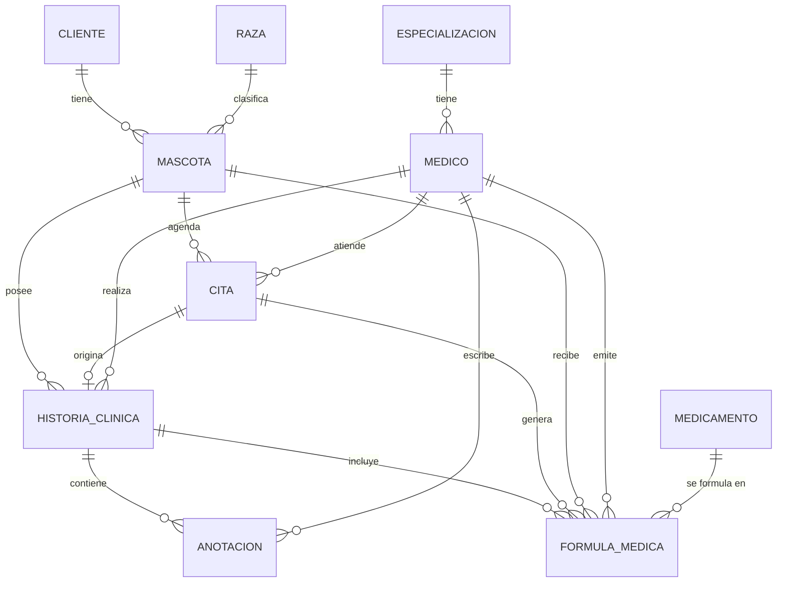

# Modelo de datos y relaciones — Centro Veterinario

## Diagrama entidad-relación

Cardinalidades del parcial (sección 7): Cliente 1:N Mascota; Mascota 1:N Cita; Cita N:1 Veterinario;
Mascota 1:N Historia clínica; Historia 1:N Anotación; Historia 1:N Fórmula médica.

## Tablas y llaves foráneas (todas obligatorias salvo indicación)

Las llaves primarias de `cita`, `formula_medica`, `historia_clinica` y `anotacion` se llaman `id`
(convención de la base existente). Las tablas se crean con los scripts de
`backend/.../resources/db/manual-migrations/` (no hay `ddl-auto`).

| Tabla | Llaves foráneas | Restricciones |
|---|---|---|
| `mascota` | `cliente_id`, `raza_id` | — |
| `Medico` | `especializacion_id` | — |
| `cita` | `cliente_id`, `mascota_id`, `medico_id` | Estado en mayúsculas (ver `EstadoCita`) |
| `historia_clinica` | `mascota_id`, `cita_id`, `medico_id` | `cita_id` **UNIQUE**: una cita genera una sola historia |
| `anotacion` | `historia_id`, `medico_id` | No puede existir sin historia |
| `formula_medica` | `mascota_id`, `cita_id`, `medico_id`, `medicamento_id`, `historia_id` (opcional) | `historia_id` se enlaza sola cuando la cita ya tiene historia |

## Cómo se evita la información huérfana

| Riesgo | Protección | Dónde |
|---|---|---|
| Registro hijo sin padre | Llaves foráneas `nullable = false` | Entidades (`@ManyToOne` + `@JoinColumn`) |
| Eliminar un padre con hijos | Se bloquea con 409 y mensaje claro | `eliminarCliente`, `eliminarRaza`, `eliminarEspecializacion`, `eliminarMascota`, `eliminarMedico`, `eliminarMedicamento` |
| Borrar información clínica | **No existe** DELETE de citas, historias, anotaciones ni fórmulas; las fórmulas se inactivan | APIs de cita y fórmula |
| Referencias cruzadas incoherentes | La cita y la fórmula deben ser de la misma mascota; la mascota debe ser del cliente; la historia debe ser de la mascota de su cita | `CitaServiceImpl`, `FormulaMedicaServiceImpl` |
| Duplicados | Cita: veterinario y mascota sin otra cita en ±15 min. Fórmula: un medicamento activo por consulta. Historia: `cita_id` único | Servicios y restricción UNIQUE |
| Fórmula sin su historia | `vincularConHistoria` enlaza las fórmulas de la cita al crear la historia | `FormulaMedicaRepository` |
| Cambiar la identidad de un registro emitido | Mascota, cita y veterinario de fórmulas y citas no se pueden modificar | `actualizarFormula`, `actualizarCita` |

Los datos referenciados que desaparecen no se borran en cascada a propósito: en un sistema clínico la
información histórica debe conservarse, así que se **protege** en lugar de eliminarse en cadena.
